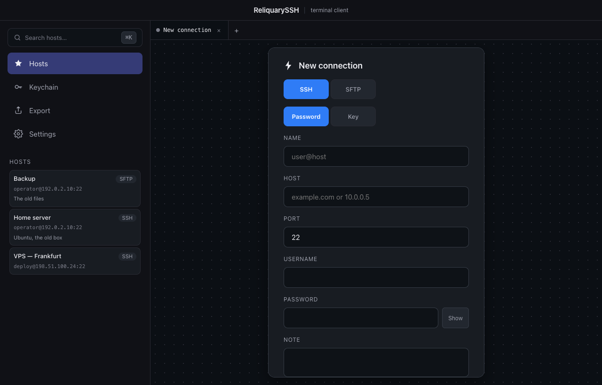
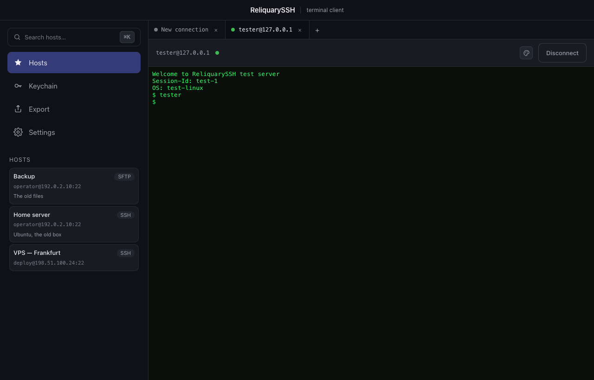
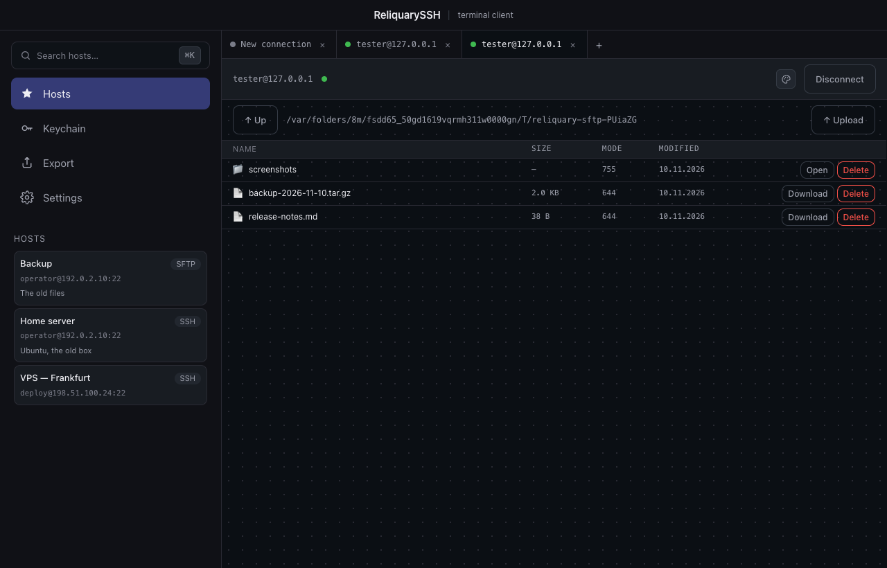
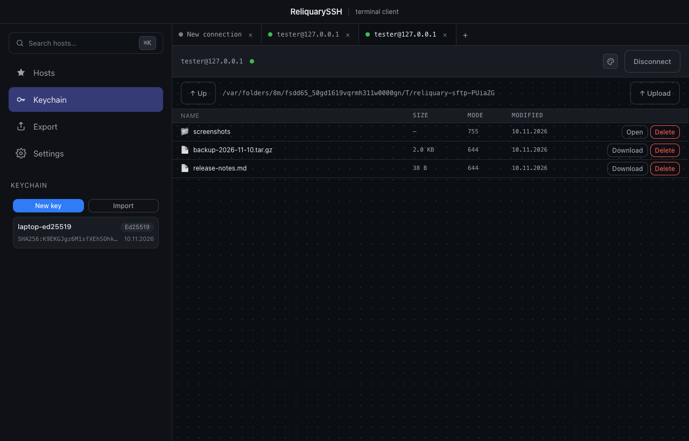
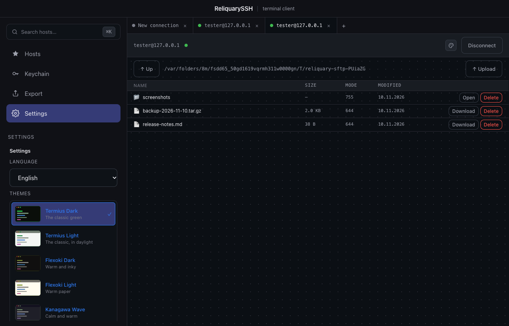

# ReliquarySSH

A terminal client for SSH and SFTP. Tabs with several parallel sessions, an SFTP
file manager, an SSH key store and a portable export — everything stays on the
machine, without an account and without a server.

Electron + React + TypeScript. SSH and SFTP work; FTP, Telnet and Serial are
reserved in the protocol interface but not implemented yet.



## What it does

| | |
| --- | --- |
| Terminal | xterm.js with a real PTY, resize, reconnect banner after a drop |
| Tabs | several independent sessions at once, the layout is restored on restart |
| SFTP | file manager: list, navigate, download, upload, delete a file or a folder |
| Keys | generate RSA / Ed25519 / ECDSA, import an existing private key, export the public key, SHA256 fingerprints |
| Hosts | name, address, port, user, notes; password or a key from the key store |
| Themes | ten terminal themes — each sets the background, the text, the ANSI palette, the font and the size |
| Language | English and Russian |
| Export | one ZIP archive with the connections, the keys and the replaced versions |

## The terminal

A real shell over SSH — `ssh2` on the main process, xterm.js in the renderer.
The PTY is resized with the window, and the session survives a broken
connection: the app shows a reconnect banner instead of dying.



Several sessions run at the same time, each in its own tab. The tabs are
restored when the app starts again, with the output that was there — the
session has to be reconnected on purpose.

## The file manager

The SFTP tab is a file manager: it lists the remote directory, walks into
the folders, downloads and uploads the files, and deletes them. A folder goes
with everything inside it, and the deletion is always asked for first.



## The key store

Keys are generated inside the app (RSA, Ed25519, ECDSA) or imported from an
existing private key. The public key is ready for `authorized_keys`, the
SHA256 fingerprint is the same one `ssh-keygen -lf` prints.

The private part never leaves the main process — the renderer only ever gets
the public half.



## The data stays on the machine

There is no server, no account and no cloud. Everything is stored in a local
SQLite database in the user data directory.

The private keys and the passwords of the hosts are encrypted at rest
(AES-256-GCM) with a key that belongs to this machine. The plaintext never
leaves the main process.

To move the data to another machine, export an archive and carry the file —
a USB stick, a cloud disk, a messenger, whatever suits:

| Step | What happens |
| --- | --- |
| Export | The app writes a ZIP archive with the connections, the keys and the versions that lost a merge |
| Carry | The user copies the file to the other device |
| Import | The other device reads the archive and merges the records it holds |

Without the option "with the passwords" the archive holds no secret at all —
only the connections and the public keys. With it the passwords of the hosts
go along **in plain text**: any unzip tool opens them, so keep the file like a
key.

The merge is last-write-wins on the modification date. A version that loses is
not deleted — it goes to the "replaced versions" list with its password, and
any of them can be restored with one click. The old password is never lost.

## The themes

Ten terminal themes, each with its own background, text colour, ANSI palette,
font and size. A theme can be picked in the settings or in a live session —
the drawer belongs to the tab it was opened in, so it never closes by itself.



## Install

The releases carry macOS builds for Apple Silicon and for Intel:

| File | Chip |
| --- | --- |
| `ReliquarySSH-0.1.1-arm64.dmg` | Apple Silicon (M1/M2/M3/M4) |
| `ReliquarySSH-0.1.1.dmg` | Intel |
| `ReliquarySSH-0.1.1-arm64-mac.zip` / `ReliquarySSH-0.1.1-mac.zip` | the same, unpacked |

The builds are not signed and not notarised, so macOS shows a warning on the
first launch — right-click the app and choose "Open", or allow it in
System Settings → Privacy & Security.

Windows and Linux are not built yet; the electron-builder targets are
prepared but commented out.

## Status

| Part | State |
| --- | --- |
| SSH terminal, tabs, multi-session | done |
| SFTP file manager | done |
| SSH key store | done |
| Local storage (SQLite) | done |
| Export and import | done |
| Terminal themes, EN/RU | done |
| macOS build (arm64 + x64) | done, unsigned |
| Host key verification | not implemented |
| Windows and Linux builds | targets are prepared, not enabled |

## Architecture

```
/app          Electron main process, preload bridge, IPC handlers
/renderer     React UI — components, styles, hooks, services
/protocols    Protocol adapters (ssh, sftp, ftp, telnet, serial) + shared adapter core
/shared       Types shared by all layers (entities, enums, export format, IPC channels)
```

Rules that hold across the whole codebase:

- TypeScript strict mode.
- The renderer never touches SQLite or SSH directly — only through `renderer/src/services/api.ts`.
- Protocol implementations are pluggable behind the `ConnectionAdapter` interface.
- Styling goes through CSS variables in `renderer/src/styles/theme.css`; no hardcoded
  colors, spacing or fonts in components.
- No macOS-only APIs without an abstraction layer.
- Secrets live in `.env` (see `.env.example`), never in the repository.
- Private keys and host passwords are stored encrypted, never in plaintext.

## Development

```sh
npm install
npm run dev        # start Electron with Vite HMR
npm run typecheck  # tsc for node and web projects
npm run lint       # eslint
npm test           # vitest
npm run build      # production build into out/
npm run package:mac # electron-builder dmg + zip for arm64 and x64
npm run icon       # regenerate build/icon.png and build/icon.icns from build/assets/logo.svg
```

### Verification harnesses

Every stage has a GUI harness that drives the real app over the Chrome DevTools
Protocol, against a real SSH or SFTP server:

```sh
node --experimental-strip-types scripts/verify-stage2.ts
node --experimental-strip-types scripts/verify-stage3.ts
node --experimental-strip-types scripts/verify-stage4.ts
node --experimental-strip-types scripts/verify-stage5.ts
node --experimental-strip-types scripts/verify-key-auth.ts
node --experimental-strip-types scripts/verify-hosts.ts
node --experimental-strip-types scripts/verify-host-form.ts
node --experimental-strip-types scripts/verify-sftp-layout.ts
node --experimental-strip-types scripts/verify-i18n.ts
node --experimental-strip-types scripts/verify-export.ts
node --experimental-strip-types scripts/verify-theme.ts
node --experimental-strip-types scripts/verify-file-delete.ts
```

`verify-stage3` and `verify-host-form` are outdated: they expect a layout that
moved into SQLite and a button that was removed. They are not regressions.

The pictures of this page are made by a harness too — `scripts/shoot-readme.ts`
opens the real app against the test servers and takes the shots:

```sh
node --experimental-strip-types scripts/shoot-readme.ts docs/screenshots
```

## Known limitations

- **The host key is not verified.** The client accepts any key of the host, so a
  man in the middle is possible. A `host_keys` table with a fingerprint and a
  dialog on the first connection is the next step.
- The device secret is a file next to the data, not the OS keychain.
- The build is not signed and not notarised — no Developer ID certificate.
- The database schema has no migrations yet: only `CREATE TABLE IF NOT EXISTS`,
  so changing a column on a live database is not supported.
- FTP, Telnet and Serial adapters are stubs.

## Roadmap

- Host key verification.
- Windows and Linux builds (the electron-builder targets are prepared, commented out).
- FTP, Telnet and Serial protocol support.
- Schema migrations for the local database and the device secret in the OS keychain.

## License

MIT
